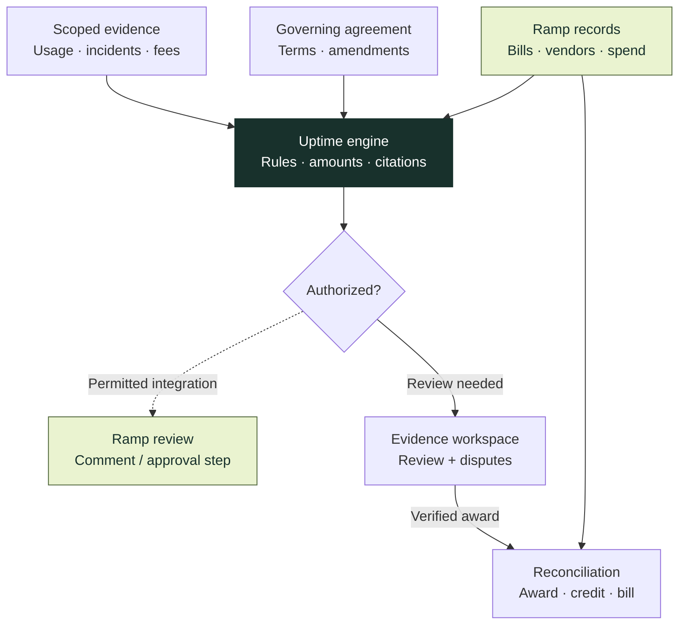
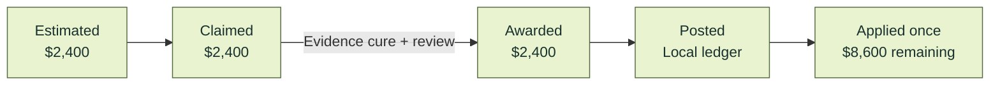

<p align="center">
  
</p>

# Uptime

**SLA and contract enforcement automation. First edition: Ramp-native.**

Uptime turns service-level agreements, negotiated pricing and contract amendments into evidence-backed financial workflows: identify an overcharge, establish a credit entitlement, investigate a denial and reconcile the outcome. Finance teams keep their bills and financial records in Ramp. Uptime supplies the contract intelligence, deterministic evaluation and audit trail around them.

Built for the **Berkeley BBS × Ramp Hackathon**.

[](https://github.com/ronoktanvir/uptime/actions/workflows/check.yml) [](pyproject.toml) [](#first-edition-ramp-native)

[Use cases](docs/product/USE-CASES.md) · [Architecture](docs/v4/ARCHITECTURE.md) · [Engineering map](docs/ENGINEERING-MAP.md) · [Run locally](#run-locally) · [Current evidence](docs/v4/STATUS.md)

## Make the agreement operational

A vendor's invoice describes what it wants to collect. The agreement determines what it may charge, which service commitments apply and when a customer may claim a remedy. Uptime connects those two records and carries the evidence through the resulting workflow.

| Finance question | Uptime's workflow | What makes the result useful |
|:---|:---|:---|
| **Are we paying the agreed price?** | Compare invoice facts with effective terms, amendments, caps and supported usage tiers. | A clause-linked calculation or an explicit missing-evidence outcome. |
| **Does this service failure qualify for a credit?** | Evaluate the applicable SLA, eligible fees, exclusions, coverage and claim deadline. | A supported entitlement with a reproducible amount. |
| **Is the vendor's denial justified?** | Preserve the reply, investigate missing evidence, prepare a permitted response or escalate ambiguity. | A dispute record that can accept a correct denial as well as challenge an incorrect one. |
| **Did the credit actually reach the bill?** | Track the award, recorded credit and allocation as separate financial events. | Exact references and remaining balances, without counting one credit several times. |
| **Can we support another vendor?** | Propose a declarative adapter, compile it, test it in shadow and require version-specific human approval. | New terms enter through a governed lifecycle with rollback. |

These are contract-specific problems. For example, Twilio's API SLA specifies claim evidence and a filing window; Atlassian's SLA distinguishes covered plans and credit application. Those differences motivate typed rules and source-linked evidence, rather than one universal outage formula. [Twilio terms](https://www.twilio.com/en-us/legal/service-level-agreement/twilio-apis) · [Atlassian terms](https://www.atlassian.com/legal/sla) · [Detailed use cases and sources](docs/product/USE-CASES.md)

## First edition: Ramp-native

**Ramp is the financial system of record.** This first product edition targets Ramp exclusively: its bills, vendors, transactions, purchase orders and supported review surfaces. The companion workspace handles deeper evidence inspection, onboarding and disputes. There is no second accounting system to adopt.

The `V3` and `V4` names in this repository describe engineering iterations within this first edition. Other financial platforms are a future direction, not shipped integrations.



Solid arrows describe implemented data and evaluation boundaries. The dashed route requires its own permission and integration proof. A **human-posted Ramp bill comment has been read back with the same real ID and body**. Uptime-origin posting, a configured approval intervention and native credit application remain unproved; a comment alone does not stop payment. [Ramp proof](docs/v4/evidence/demo-path-87/human-ramp-note.json) · [Supported integration surfaces](docs/v4/RAMP-FEASIBILITY.md)

## A case you can follow, down to the clause

The Northwind walkthrough exercises the existing engines with an **authored agreement and authored usage, invoice and vendor-response records**. Its initial monthly fee is $12,000; a dated amendment changes both the fee and cap to $11,000 from March. The SLA defines a 99.9% commitment, completed-step credits and a 30-day claim window.

| Period | Evidence and contractual result | Financial treatment |
|:---|:---|:---|
| **January** | 135 eligible unavailable minutes out of 44,640; two completed credit steps. | `20% × $12,000.00 = $2,400.00` eligible credit. |
| **February** | 5 unavailable minutes out of 40,320; SLA threshold met. | Ineligible for an SLA credit. |
| **March** | Incomplete usage coverage; $12,000 billed against the amended $11,000 fee. | SLA outcome **unknown**; separate **$1,000** price finding stays open. |
| **April settlement** | The awarded January credit is applied once to the $11,000 April invoice. | `$11,000.00 − $2,400.00 = $8,600.00` outstanding. |



These are successive states of **one $2,400 credit**, not additive recovery metrics. The destination is the Local ledger; no Ramp cash recovery is claimed. The separate DocuSign bill in Ramp has its own evidence-gap note and is not governed by the Northwind agreement.

[Contract and evidence package](fixtures/northwind/README.md) · [Eleven-action read-back proof](docs/v4/evidence/demo-path-87/northwind-socket.json) · [Presentation script](docs/v4/DEMO-PATH-87.md)

## AI proposes. Deterministic code decides.

| Layer | Responsibility | Boundary |
|:---|:---|:---|
| **Contract intelligence** | Extract supported propositions and retain their exact source references. | Model output is a proposal, not authority. |
| **Financial evaluation** | Apply supported amendments, eligibility rules, deadlines, exclusions and tier mathematics. | Typed inputs, decimal arithmetic and explicit unknown outcomes. |
| **Action control** | Bind a reviewer, policy, scope, version and exact request. | A model cannot grant itself permission or invent an award. |
| **State and delivery** | Preserve filing history, idempotency, credit allocations and audit events. | Retry uncertainty must be reconciled before another external effect. |

Generated adapters are declarative data, not executable model-generated code. The adversarial counterparty evaluates submitted claims against contract inputs and evidence. Missing evidence, correct denials and ambiguous replies have distinct outcomes.

[Financial engine](uptime/pricing.py) · [Vendor registry](uptime/vendor_registry.py) · [Dispute service](uptime/correspondence_service.py) · [Credit synchronization](uptime/ramp_credit_sync.py) · [Architecture decisions](docs/v4/decisions/INDEX.md)

## Engineering you can inspect

The repository records implementation, verification and unresolved questions separately. The interactive dependency map links tasks to their prerequisites, owners and evidence; the [engineering map](docs/ENGINEERING-MAP.md) provides a readable entry point directly on GitHub.

| Workstream | Demonstrated | Still open |
|:---|:---|:---|
| **Ramp integration** | Same-business record reads; human-posted bill comment with repeat same-ID read-back. | Uptime-origin write and native credit application. |
| **Contract and pricing** | Source-linked Northwind outcomes; effective amendments; missing-evidence handling. | Broader invoice, document, currency and contract coverage. |
| **Onboarding** | Actual Opus proposal through the app; typed compilation, shadow tests and versioned lifecycle controls. | Reliable unseen-vendor generalization and the pending live human promotion. |
| **Disputes** | Authored denial → verified evidence → response → award flow; deterministic denial/escalation controls. | Fresh independent reply evaluation and real vendor delivery. |
| **Security and finance** | Signed requests, scoped authority, duplicate-action controls and separate financial stages. | Hosted customer identity, OAuth installation and operational validation. |

**Recorded checkpoint:** `6bedefc` passed **3,967 Python tests, 1 warning in 232.13 seconds**. The published `98de9b6` checkpoint also passed [GitHub CI](https://github.com/ronoktanvir/uptime/actions/runs/42437918366). These are regression results, not a production-readiness or model-accuracy score. Earlier independent failures and the next frozen evaluation remain visible in the [team handoff](docs/v4/TEAM-DECISION-HANDOFF.md).

## Run locally

For the application, use **Python 3.11–3.14 and uv**. Node is needed for the JavaScript checks. Credentials and runtime databases stay outside the checkout.

```sh
git clone https://github.com/ronoktanvir/uptime.git
cd uptime
uv sync --locked
```

**Explore the engineering map** without Ramp credentials or application setup:

```sh
python3 scripts/serve_progress.py --port 8780
```

Open [localhost:8780](http://127.0.0.1:8780/). Each teammate can run it from their own clone. The map is a timestamped maintained snapshot, not a live agent monitor. [Access and updates](progress/README.md)

**Run the authored financial walkthrough** in a fresh directory outside the repository:

```sh
uv run --locked python scripts/setup_northwind.py \
  --directory "$HOME/.local/share/uptime/northwind-first-run" \
  --origin http://127.0.0.1:8776 --serve
```

Open [localhost:8776](http://127.0.0.1:8776/), sign in as `scripted-test-reviewer`, and select `scripted-reviewer.jwk` from that new directory. For an existing run, add `--resume`; do not replace its state. The walkthrough's scripted reviewer is separate from the pending live teammate review. [Full setup](docs/v4/NORTHWIND-WORKFLOW.md)

For the connected Ramp worklist, macOS users can run `./Open\ Uptime.command`. Follow the [operator guide](docs/v4/OPERATIONS.md) and [connection guide](docs/v4/RAMP-DEMO-CONNECTION.md) for installation-specific setup. These are local development services, not a public deployment.

## Verify and contribute

```sh
uv run --locked pytest
node --test web/*.test.cjs tests/helpers/*.test.cjs
node scripts/test_progress_graph.cjs
uv run --locked python scripts/rehearse.py
uv run --locked python scripts/check_repo.py
```

[Contribution workflow](CONTRIBUTING.md) · [Engineering map](docs/ENGINEERING-MAP.md) · [Capability matrix](docs/v4/CAPABILITIES.md) · [Decision records](docs/v4/decisions/INDEX.md) · [Original specification](docs/uptime-v3/Uptime_V3_Product_Technical_Spec.md)
