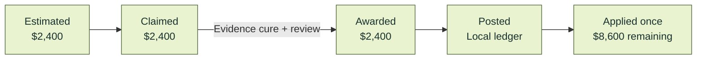

<p align="center">
  
</p>

# Uptime

**Uptime checks vendor bills against the contracts behind them (SLA credits, negotiated prices, amendments) and carries each finding from clause to claim to credit. The first edition is built around Ramp.**

Built for the **Berkeley BBS × Ramp Hackathon: Automate the Old Way**.

[](https://github.com/ronoktanvir/uptime/actions/workflows/check.yml) [](pyproject.toml) [](#where-ramp-fits)

[Run it](#run-it) · [Judge guide](docs/JUDGES.md) · [What works today](#what-works-today) · [Unfamiliar contracts](docs/v4/evaluation-finish-20261109/RESULTS.md) · [Architecture](docs/v4/ARCHITECTURE.md)

<!-- VIDEO: add the two-minute film link here only once the recording exists. -->

<!-- SCREENSHOT 1 (phase 2, from the frozen build): docs/assets/submission/overview.png — Overview after the four decisions: April $11,000.00 → $8,600.00, the open $1,000.00 March finding, the credit lifecycle. -->

## The old way

A service credit is rarely automatic. Under [Twilio's API SLA](https://www.twilio.com/en-us/legal/service-level-agreement/twilio-apis) (section 3, last updated April 9, 2026), the customer opens a support request with the subject "SLA Claim", lists the dates and times of the outage, attaches documentation, and does it within 30 days of the end of the month. The credit is 10% of the affected month's fees, applied to future charges and never refunded. Negotiated prices have the same gap: an amendment lowers the fee, and the next invoice can still arrive at the old one.

| | The old way | With Uptime |
|:---|:---|:---|
| **Know what you are owed** | Reread the SLA, the order form and every amendment. | Terms become typed rules, each linked to its clause. |
| **Prove it** | Total the downtime in a spreadsheet. | Evidence is matched to the service month. Missing evidence gives "needs evidence", never a guess. |
| **Claim it in time** | Remember the window, write the ticket. | The deadline is tracked; the claim packet waits for a person's approval. |
| **Handle the reply** | Hunt for whatever the vendor asks for. | A request in wording the rules know is answered with evidence that arrives through a signed source and is matched to it. Other wording goes to a reviewer. |
| **Confirm the money** | Hope the next invoice is lower. | Claimed, awarded, posted and applied are separate stages of one credit, applied once. |

We do not publish a time or dollar saving: no measurement supports one, and public outage reports alone cannot establish what a particular customer is owed.

## How it works

1. **Read.** Known contract wording is parsed deterministically. For other wording, Claude Opus 5.5 proposes the terms as data, each tied to the sentence it came from. Code validates the proposal; a passing one is staged in shadow and takes effect only when a reviewer approves that exact version.
2. **Decide.** Code computes eligibility, deadlines and money with exact decimal arithmetic. A model never decides an amount, and unknown stays unknown.
3. **Act.** Uptime runs routine steps itself: taking in replies and evidence that arrive through signed sources, matching them, and sending a response a reviewer already approved. It stops for every judgment and every financial change.

## One case, down to the clause

The walkthrough runs one agreement through the same engines as everything else. **Its contract, usage records and invoices are authored for the demo; the vendor (Northwind Cloud) and buyer are fictional.** The vendor's replies come from a local counterparty built into Uptime, and credits are recorded in a local ledger. Nothing is sent to a real vendor or written to Ramp.

The SLA promises 99.9% monthly availability, a 10% credit for each completed 0.1 point of shortfall and a 30-day claim window. An amendment lowers the monthly fee from $12,000 to $11,000 from March.

| Period | What Uptime found | Result |
|:---|:---|:---|
| **January** | 135 unavailable minutes of 44,640: two completed steps below target. | `20% × $12,000.00 = $2,400.00` credit. Claimed, awarded after an evidence cure, then applied once to April's bill: `$11,000.00 − $2,400.00 = $8,600.00`. |
| **February** | 5 unavailable minutes of 40,320: target met. | Not eligible. No claim. |
| **March** | Usage evidence is incomplete. | SLA outcome **not determined**. |
| **March invoice** | Billed $12,000.00 after the amendment set $11,000.00. | **$1,000.00** price finding, open before payment and separate from the credit. |



These are stages of **one $2,400 credit**, not amounts to add, and the $1,000 price finding is not a credit. [Contract and evidence package](fixtures/northwind/README.md) · [Workflow read-back receipt](docs/v4/evidence/demo-path-87/northwind-socket.json)

## Run it

You need Git, Python 3.11–3.14 and [uv](https://docs.astral.sh/uv/). No Ramp account, credentials or model access are needed.

```sh
git clone https://github.com/ronoktanvir/uptime.git && cd uptime
uv run --locked python scripts/setup_northwind.py --directory "$HOME/uptime-demo/northwind-01" --serve
```

The second command installs the locked dependencies, builds a fresh walkthrough workspace in that folder and serves it.

1. Open [127.0.0.1:8776](http://127.0.0.1:8776/).
2. Sign in with the account name and credential file the command prints. The account, `scripted-test-reviewer`, is a scripted test reviewer, not a person.
3. On **Overview**, approve the January claim. Uptime files it and takes in the vendor's reply. The requested log and its verification then arrive through a signed source, from two separate senders, and Uptime matches them, drafts a response and stops for you. Four decisions in all (approve the claim, approve the response, post the credit, apply it) bring April's bill to $8,600.00.

Use a new folder name for each fresh run; add `--resume` to reopen one. [Full setup and troubleshooting](docs/v4/NORTHWIND-WORKFLOW.md)

## Where the model fits

<!-- SCREENSHOT 2 (phase 2, from the frozen build): docs/assets/submission/contract-reading.png — a recorded Claude Opus 5.5 reading of an authored contract: each proposed term beside its quoted sentence, the validation result and the shadow state. -->

Claude Opus 5.5 does two things. It proposes contract terms for wording the fixed rules do not know, and it proposes a reading of a vendor's reply, with the cited text, for a reviewer to check. Both run through the ordinary application routes. Before each call, an operator records permission for that exact request, covering the model call only. In these runs the operator was the engineering agent running the demonstration, named as such in the receipts. The model gets no tools. Its output is a proposal: it cannot approve itself, invent evidence or set an amount. Northwind's own agreement is read by fixed rules with no model call. So is its vendor's request for a log, which uses wording the rules know; a request worded differently goes to a reviewer.

**On authored contracts, recorded November 9:**
- Of two contracts written inside the supported grammar, one (Corvid Ledger) reached shadow with 11 exact quotations from its text.
- The other (Halden Relay) was refused for the same vendor-naming reason as the independent cohort.
- A third, a deliberate control, was refused.
- An authored unclear vendor reply was read as unsupported, citing the whole reply, and went to a reviewer with nothing awarded.
- The model was called once per rule family: two calls per contract, six for the three contracts, and one more for the unclear reply. Each call took 5–15 seconds, and none was retried.

[Recorded runs](docs/v4/submission/onboarding-runbook.md) · [Recorded reply reading](docs/v4/evidence/submission-disputes-20261109/denial-model-job.json)

**On contracts it has not seen, it is not reliable yet.** In the latest independent first pass, 12 actual Opus calls returned and all 12 proposals failed validation: 0 of 4 intended positive contracts reached shadow, all 6 contracts were refused, and all 8 dispute cases stopped at setup, so held-out dispute accuracy is unmeasured. Earlier first attempts (0 of 4, 3 of 6, 0 of 50) and a refused public SLA (Backblaze) stand as recorded. A refusal names the passage it stopped at; it never produces a number. [Independent results](docs/v4/evaluation-finish-20261109/RESULTS.md)

## Where Ramp fits

<!-- SCREENSHOT 3 (phase 2, from the frozen build): docs/assets/submission/ramp-record.png — the verified Ramp record for sandbox bill f74ba12c: business, read time, the person-posted note and its API read-back. -->

The first edition is a **Ramp-focused integration that runs beside Ramp**, as a separate local application; it is not embedded in Ramp's interface. Ramp stays the system of record. It is integrated with Ramp's developer API, read-only: when a person starts a read, Uptime reads bills, vendors, transactions, purchase orders and approvals from the demo sandbox. It shows when each record was read and whether the list was complete.

What has reached Ramp is one evidence-gap note on sandbox bill `f74ba12c-95d0-582d-9f62-26d8057d1d37`. **A person typed it; Uptime read it back through the API.** Nothing has been written to Ramp by Uptime: an agent-run posting was refused by an automatic approval review of the agent's action and is not retried, so only a person may run that route. Ramp's published developer API has no operation to create or apply a vendor credit (checked November 9), so a credit would be recorded by a person in Ramp and read back by Uptime; that path is not demonstrated yet. Payment holds and approval-chain steps are not built. The Northwind walkthrough is deliberately kept apart from Ramp, and its agreement is never attached to an unrelated Ramp bill. [Read-back receipt](docs/v4/evidence/demo-path-87/human-ramp-note.json) · [Supported Ramp surfaces](docs/v4/RAMP-FEASIBILITY.md)

**Browser side panel.** A Chrome side panel can show Uptime's page for the Ramp bill open in the active tab, beside Ramp. It is a browser side panel, not a Ramp integration: it reads only the active tab's address, nothing runs inside Ramp, and nothing is written to Ramp. It is off unless the Uptime server is started with the extension's one allowed origin. [How to load it](extension/README.md)

## What works today

| Area | What works | Limits that matter |
|:---|:---|:---|
| **Money engine** | SLA credits, price checks, amendments, deadlines, exclusions and credit allocation, with exact decimal arithmetic and a clause citation for every amount | Supports specific contract wording families; anything else is refused, with the passage named |
| **Contract reading** | Deterministic parser for known wording; Claude Opus 5.5 proposals for other wording, validated by code and staged in shadow | Not reliable yet: 1 of 2 authored contracts reached shadow in the demo's recorded runs, and 0 of 4 intended positives in the latest independent pass |
| **Disputes** | Denial → evidence cure → reviewed response → award, with routine steps run automatically and a reviewer deciding each judgment; for a reply the rules do not recognize, the model proposes a reading with the cited text, for a reviewer to check | Evidence requests are recognized only in wording the rules know; other wording goes to a reviewer. Held-out dispute accuracy unmeasured. Replies come from a local counterparty; no real vendor is contacted |
| **Approvals** | A reviewer approves the claim, the response, posting and application; each approval is bound to the exact content approved | In the walkthrough the presenter acts as a scripted test reviewer account; that is not a record of an enrolled person's approval |
| **Ramp reads** | Bills, vendors, transactions, purchase orders and approvals from the Ramp sandbox, with read time and completeness | Read-only, and a person starts each read; the demo uses the sandbox, not a customer business |
| **Ramp write-back** | One person-posted note, read back by Uptime through the API | No Uptime-originated Ramp write; vendor credits, payment holds and approval steps in Ramp are not built |
| **Where credits land** | A local ledger, with exact bill and remaining balance | Not money recovered in Ramp |
| **Hosting** | Local, loopback-only application | No hosted installation or Ramp OAuth sign-in yet |

[Full capability matrix](docs/v4/CAPABILITIES.md)

## Verification

The badge above runs the full check suite on every push to `main`. The frozen submission build's full run is recorded with its exact commit, command and log in [this receipt](docs/v4/evidence/submission-20261109/suite-52f1a2f.json). These are regression results, not a measure of model accuracy or production readiness. An independent acceptance run on a fresh clone of that build followed only these published instructions; its results, limits and ranked findings are in [the acceptance report](docs/v4/submission/acceptance.md) ([summary](docs/JUDGES.md#independent-acceptance)).

```sh
uv run --locked pytest
node --test web/*.test.cjs tests/helpers/*.test.cjs
uv run --locked python scripts/rehearse.py
uv run --locked python scripts/check_repo.py
```

## Engineering records

Everything below is engineering history: how the product was built, tested and decided. None of it is needed to run the walkthrough.

- [Engineering map](docs/ENGINEERING-MAP.md): what is demonstrated and what is still open. The interactive dependency map runs locally with `python3 scripts/serve_progress.py --port 8780`, then [127.0.0.1:8780](http://127.0.0.1:8780/) ([access and updates](progress/README.md)).
- [Current status](docs/v4/STATUS.md) · [Capability matrix](docs/v4/CAPABILITIES.md) · [Decision records](docs/v4/decisions/INDEX.md) · [Use cases and sources](docs/product/USE-CASES.md)
- [Independent evaluation results](docs/v4/evaluation-finish-20261109/RESULTS.md) · [Remediation pass](docs/v4/FINISH-20261109.md) · [First public baseline](docs/v4/evaluation76/BASELINE.md)
- Connected Ramp worklist: `./Open\ Uptime.command` on macOS, with the [operator guide](docs/v4/OPERATIONS.md) and [connection guide](docs/v4/RAMP-DEMO-CONNECTION.md). These are local development services, not a public deployment.
- [Contribution workflow](CONTRIBUTING.md) · [Original specification](docs/uptime-v3/Uptime_V3_Product_Technical_Spec.md)
