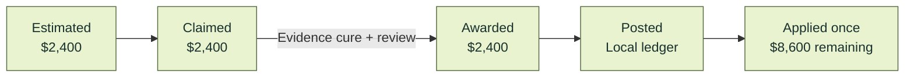
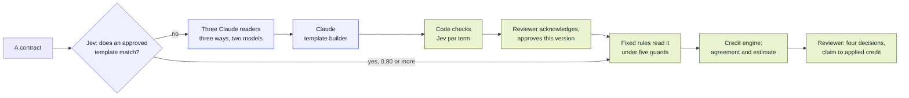

<p align="center">
  
</p>

# Uptime

**Uptime checks vendor bills against the contracts behind them (SLA credits, negotiated prices, amendments) and carries each finding from clause to claim to credit. The first edition is built around Ramp.**

Built for the **Berkeley BBS × Ramp Hackathon: Automate the Old Way**.

[](https://github.com/ronoktanvir/uptime/actions/workflows/check.yml) [](pyproject.toml) [](#where-ramp-fits)

[Run it](#run-it) · [Where the AI is](#where-the-ai-is) · [Where Ramp fits](#where-ramp-fits) · [What works today](#what-works-today) · [Judge guide](docs/JUDGES.md)

<p align="center">
  
</p>

<p align="center"><em>A bill in Ramp's sandbox with Uptime's side panel beside it. The bill and Uptime's note are real records in Ramp's sandbox; the panel is Uptime's real page for that bill. The browser window around them is drawn. The screenshots below are of the application itself.</em></p>

## The old way

A service credit is rarely automatic. Under [Twilio's API SLA](https://www.twilio.com/en-us/legal/service-level-agreement/twilio-apis) (section 3, last updated April 9, 2026), the customer opens a support request with the subject "SLA Claim", lists the dates and times of the outage, attaches documentation, and does it within 30 days of the end of the month. The credit is 10% of the affected month's fees, applied to future charges and never refunded. Negotiated prices have the same gap: an amendment lowers the fee, and the next invoice can still arrive at the old one.

| | The old way | With Uptime |
|:---|:---|:---|
| **Know what you are owed** | Reread the SLA, the order form and every amendment. | Terms become typed rules, each linked to its clause. |
| **Prove it** | Total the downtime in a spreadsheet. | Evidence is matched to the service month. Missing evidence gives "needs evidence", never a guess. |
| **Claim it in time** | Remember the window, write the ticket. | The deadline is tracked; the claim packet waits for a reviewer's approval. |
| **Handle the reply** | Hunt for whatever the vendor asks for. | A request in wording the rules know is answered with evidence that arrives through a signed source and is matched to it. Other wording goes to a reviewer. |
| **Confirm the money** | Hope the next invoice is lower. | Claimed, awarded, posted and applied are separate stages of one credit, applied once. |

We do not publish a time or dollar saving: no measurement supports one, and public outage reports alone cannot establish what a particular customer is owed.

## What it looks like

**1. It starts on the bill, in Ramp.** Uptime reads bills through Ramp's API and matches each to an invoice under a vendor agreement by vendor, invoice number and amount. On a match it leaves a note on the bill, and its side panel beside Ramp shows the credit, the clause it comes from, quoted exactly, and the inputs. A bill with no agreement behind it says so.

**2. One page for every vendor, contract and month.** The portfolio lists each opportunity on its own row (a month's service credit, a price finding, an estimate for a second vendor, a bill with no agreement) and counts who did the work: Claude, Uptime's fixed rules, the reviewer.

<p align="center">
  
</p>

**3. A contract type it has never read gets a reader built for it.** Three Claude agents read the contract in three different ways, one of them on a different model, and a fourth writes a template: one extraction rule per term, stored as data. Code checks that every quote is in the contract and every value is in its sentence, and compares the template with three fresh readings of a second contract. Jev, a decision model, checks each term against its sentence; a term it does not support has to be acknowledged by the reviewer before that exact version can be approved. [More below.](#where-the-ai-is)

<p align="center">
  
</p>

**4. From then on, fixed rules read it and the credit engine prices it.** Once a reviewer has approved that exact version, the contract is read by the template's rules under five guards; no model reads or computes a value. The same credit engine as everywhere else turns the seven terms into an agreement in shadow and an estimated credit: $2,000.00 for October 2026 in the shipped sample. The next contract of the same type starts no Claude agent at all: Jev recognises the approved template and the rules read it.

<p align="center">
  
</p>

**5. The claim takes four reviewer decisions, however the contract was read.** Approve the claim; Uptime files it, takes in the vendor's request for a log and the log's verification, and drafts the response. Approve the response; the vendor awards the credit. Two more decisions post it and apply it. After each decision the steps it set off are shown one at a time, tagged by who took them.

The credit from the contract the Claude agents' template read goes that way: $2,000.00 against December's invoice, $8,000.00 down to $6,000.00 in Uptime. The case page says how its contract was read.

<p align="center">
  
</p>

Northwind's contract was read by fixed rules from the start. The same four decisions take April's invoice from $11,000.00 to $8,600.00.

<p align="center">
  
</p>

**6. And back on the bill.** Uptime's second note says the credit was awarded and what the balance is in Uptime. The vendor's credit sits on file in Ramp, not yet applied: [what that means](#where-ramp-fits).

## How it works

1. **Read.** Known contract wording is parsed by fixed rules. For other wording, Claude Opus 5.5 proposes the terms as data, each tied to the sentence it came from, and code validates the proposal. For a new contract type, several Claude readers and a template builder produce rules that a reviewer approves once. Nothing a model proposes takes effect until a reviewer approves that exact version.
2. **Decide.** Code computes eligibility, deadlines and money with exact decimal arithmetic. A model never decides an amount, and unknown stays unknown.
3. **Act.** Uptime runs routine steps itself: taking in replies and evidence that arrive through signed sources, matching them, and sending a response a reviewer already approved. It stops for every judgment and every financial change.

## One case, down to the clause

The walkthrough runs one agreement through the same engines as everything else. **Its contract, usage records and invoices are authored for the demo; the vendor (Northwind Cloud) and buyer are fictional.** The vendor's replies come from a local counterparty built into Uptime, and credits are recorded in a local ledger. Nothing is sent to a real vendor. In Ramp's sandbox, the only thing Uptime writes is a note on the bill.

The SLA promises 99.9% monthly availability, a 10% credit for each completed 0.1 point of shortfall and a 30-day claim window. An amendment lowers the monthly fee from $12,000 to $11,000 from March.

| Period | What Uptime found | Result |
|:---|:---|:---|
| **January** | 135 unavailable minutes of 44,640: two completed steps below target. | `20% × $12,000.00 = $2,400.00` credit. Claimed, awarded after an evidence cure, then applied once to April's bill: `$11,000.00 − $2,400.00 = $8,600.00`. |
| **February** | 5 unavailable minutes of 40,320: target met. | Not eligible. No claim. |
| **March** | Usage evidence is incomplete. | SLA outcome **not determined**. |
| **March invoice** | Billed $12,000.00 after the amendment set $11,000.00. | **$1,000.00** price finding, open before payment and separate from the credit. |



These are stages of **one $2,400 credit**, not amounts to add, and the $1,000 price finding is not a credit. [Contract and evidence package](fixtures/northwind/README.md) · [Workflow read-back receipt](docs/v4/evidence/demo-path-87/northwind-socket.json)

**A second case, from a contract Claude read.** The Halcyon Grid addendum is authored too, and its vendor is as fictional as Northwind. The terms the engine used were not typed in: three Claude readers read the contract, a template was built and approved, and that template's rules read 99.95% monthly availability, a 10% credit below 99.95% and 25% below 99.5%, a 30% cap and a 30-day claim window. October 2026 had 263 unavailable minutes of 44,640, which is 99.410%: `25% × $8,000.00 = $2,000.00`, claimed, awarded after the vendor asked for a service log, and applied once to December's invoice: `$8,000.00 − $2,000.00 = $6,000.00`. The contract states no fee; the $8,000.00 comes from an authored order form. [Evidence and its limits](fixtures/template_builder_demo/evidence/halcyon-a/README.md)

## Run it

You need Git, Python 3.11–3.14 and [uv](https://docs.astral.sh/uv/). No Ramp account, credentials or model access are needed for the walkthrough.

```sh
git clone https://github.com/ronoktanvir/uptime.git && cd uptime
uv run --locked python scripts/setup_northwind.py --directory "$HOME/uptime-demo/northwind-01" --serve
```

The second command installs the locked dependencies, builds a fresh walkthrough workspace in that folder and serves it.

1. Open [127.0.0.1:8776](http://127.0.0.1:8776/).
2. Sign in with the account name and credential file the command prints. The account, `scripted-test-reviewer`, is a scripted test reviewer, not a person.
3. **Overview** is the portfolio. Open **Northwind Cloud · January 2026** and approve the January claim. Four decisions in all (approve the claim, approve the response, post the credit, apply it) bring April's bill to $8,600.00.

Use a new folder name for each fresh run; add `--resume` to reopen one. [Full setup and troubleshooting](docs/v4/NORTHWIND-WORKFLOW.md)

Optional, each added to the same command:

| Option | What it turns on | What it needs |
|:---|:---|:---|
| `--template-builder` | On **Agreements**, "Build a reader with Claude agents" for the shipped sample or a contract you paste. | The [Claude Code CLI](https://claude.com/claude-code), signed in on this machine. For Jev's checks, a TypeSafe API key saved in `~/.config/uptime/jev-api-key`; without it the run says Jev could not be reached and shows no Jev result. |
| `--model-jobs` | Live Claude readings of three sample contracts on **Agreements**. | The Claude Code CLI. |
| `--ramp-records DIR` | Bills read from Ramp, matched to invoices, on the portfolio and in the panel. | Records read from your own Ramp sandbox: [connection guide](docs/v4/RAMP-DEMO-CONNECTION.md). |
| `--ramp-notes` or `--ramp-notes auto` | Uptime's notes on matched bills, by a button or by itself. | A Ramp sandbox credential with `bills:write`. |
| `--side-panel-origin chrome-extension://ID` | The Chrome side panel beside Ramp. | [Loading the extension](extension/README.md). |

## Where the AI is

Models propose. Code and a person decide. No model computes money, and nothing a model writes runs as code.



**Building a reader.** One real run on the shipped sample, the one in these screenshots (November 10):

<p align="center">
  
</p>

- **Seven terms, and the credit schedule is one of them.** A schedule holds one to six tiers, each "below X% earns Y%"; a single flat credit is a schedule of one. The claim window and the maintenance notice keep the unit the contract writes.
- **Three Claude readers that differ.** One reads clause by clause (Opus 5.5, 12.2 s). One lists every number in the contract first (Opus 5.5, 12.8 s, 25 numbers). One looks for a second statement that conflicts (Sonnet 5.5, 11.8 s, none found). Tools are off. All 24 quotes were in the contract word for word, and the three agreed on all seven terms. For the two terms that are a choice, each reader also gives the contract's own words for it: here "each calendar month" and "applied as a credit against the next invoice".
- **A fourth Claude call** wrote seven extraction rules in 18.4 s. A rule is a regular expression with a type; the schedule's rule is a pattern per kind of row, and every match is a tier. The interpreter runs a rule with a length limit and a time limit, refuses a rule that contains the value it is meant to find, and refuses a rule that matches in two places with different values.
- **Code checks block approval if they fail.** Every value is literally in its sentence; for the schedule, each tier's credit is in that tier's own sentence with its threshold or a reference to the commitment (7 of 7). The template returns every term from the contract (7 of 7). On a second contract of the same form it returns what three fresh readers agreed on (7 of 7); there is no answer key.
- **Jev gates approval.** [TypeSafe AI](https://docs.typesafe.ai/)'s decision model (`jev-1.13.0`) answers whether each term, and each tier of the schedule, is supported by its sentence. It supported five terms at 95% or more. The schedule's first tier came back at 74% and the payment term at 88%, both under the 0.90 bar, and "Approve" stayed disabled until the reviewer had ticked each. Both values were in fact right: on this sample the bar raises false alarms, and what it catches has not been measured. Jev is never used for arithmetic, dates or deadlines.
- **A term the contract does not state** is recorded as not stated, gets no rule, and must be acknowledged too. Units are never converted: five business days of notice stays five business days.

**After approval, Jev routes.**

<p align="center">
  
</p>

- The next contract of the same type was pasted in. Jev matched it to the approved template at 95% in 0.3 s, and no Claude agent started.
- Fixed rules read it in 5.9 ms under five guards: every rule found a value; no rule matched in two places with different values; each value is in the sentence its rule matched; the values fit together; and Jev agrees the document follows the template. A read that fails a guard is refused whole.
- A pasted contract has no usage on file, so its agreement shows "Needs usage evidence" and no credit. The estimate below is for the sample contract, which comes with an authored usage month.
- With no approved template on file there is nothing for Jev to match, so it is not asked and the readers start. Once a template exists, if Jev cannot be reached nothing starts until a reviewer chooses to build without it.

**The money link.** An accepted read becomes an agreement in shadow, and the same credit engine evaluates an authored usage month against it. For the sample: 44,377 of 44,640 minutes available in October 2026 (99.410%), the 25% tier, $2,000.00 on an $8,000.00 fee. No model takes part in that. It refuses, with the reason, when the read lacks a term it needs (a cap the contract does not state), when the claim window is not in calendar days, when the contract measures something other than a calendar month, or when a credit is paid some other way than against the next invoice.

**The claim.** From that agreement a reviewer can open the claim. The first decision is bound to what the page showed: the reading, the template's SHA-256, the values read, the hashes of the evidence files and the estimated amount. Under it Uptime installs the read terms through the engine's own compiler, where a set of hand-computed cases has to pass, opens the claim, takes in the month's records through the signed sources, and checks that the claim the engine assessed is the one shown, same month and same amount, before the approval is recorded. Every later decision is the Northwind workflow's own, unchanged: the same workflow code, claim state machine and signed sources, run in the case's own database, so the two cases never share a clock or a ledger. In the recorded run that was 4 reviewer decisions and 12 automatic steps, ending with December's invoice at $6,000.00. The portfolio lists the case beside the others and counts its steps:

<p align="center">
  
</p>

That picture is from a workspace started without the Ramp options, so no note was posted from it; the Northwind claim was left untouched there.

**On contracts it was not written for.** Two measurements, each published as it came out.

*Six contract forms written blind by separate Claude calls*, frozen, and run as the engine changed. Each form has a contract to build from, a second for the check, and a third held out for the read:

| Run | Engine | Forms that passed every blocking check | Held-out terms correct | Wrong | Unread | Not stated |
|:---|:---|:---|:---|:---|:---|:---|
| 1 | First version, given an answer key for the second contract | 5 of 6 | 36 | 0 | 4 | 5 |
| 2 | No answer key, every value in its sentence, all nine terms required | 1 of 6 | 9 | 0 | 0 | 0 |
| 3 | A term the contract does not state is recorded, not refused | 4 of 6 | 25 | 0 | 8 | 3 |
| 4 | Current engine: seven terms, a credit schedule, durations in the contract's unit | 4 of 6 | 14 | 0 | 13 | 1 |

No run returned a wrong value; every miss was a blank or a refusal. Run 2 fell because five of the six forms state maintenance notice in days or business days and the engine demanded hours. Runs 3 and 4 were each changed after seeing the earlier runs on these same forms, so neither is a clean held-out number, and run 4 scores seven terms a contract where the others score nine. In run 4, two of the four templates that passed then refused their held-out contract whole, because its author had reworded a clause; the two that read were right on 7 of 7. A script, not a person, made the acknowledgements and approvals in every run. [All four runs, form by form](docs/demo/TEMPLATE-BUILDER-HELDOUT.md)

*Real, public SLA pages*, one build a page. A page counts as read only when its template passed every blocking check, was approved, and then read the page back under the guards; anything else returns nothing. "Shown to a reviewer" is what the three readers agreed on, whether or not the build could be approved.

| Pages | Read back | Values returned: correct | Wrong | Shown to a reviewer: correct | Wrong | Not read |
|:---|:---|:---|:---|:---|:---|:---|
| 13 pages from 11 vendors (AWS, Google Cloud, DigitalOcean, Backblaze, MongoDB, Twilio, Mailgun, GitHub, Vercel, Atlassian, Cloudflare), with nothing changed after seeing them | 1 of 13 | 4 | 0 | 53 | 0 | 13 |
| 13 fresh pages from 13 other vendors, chosen after the fix below was committed, with the answer key committed before any build | 3 of 13 | 18 | 0 | 47 | 1 | 12 |
| The same fresh 13 a second time, with the reader prompt's example phrases replaced. A check, not a clean number: the pages had been seen once | 7 of 13 | 38 | 1 | 54 | 1 | 5 |
| The first 13 again after the fix. Not a clean number: the fix was made from them | 5 of 13 | 23 | 0 | 44 | 0 | 22 |

- **The fix between the first two rows.** Most of the first refusals came from one code check that looked for fixed words such as "month" and "invoice" beside two of the terms, where real SLAs say "monthly billing cycle" or "future payments". The readers were right and the check refused them. The word list is gone: a reader now gives the contract's own words for the option, the three must agree on the option and the words, the rule must capture those words, and Jev is asked about them.
- **The fresh pages.** Civo, OneUptime and Upstash were read back, each with a schedule of three tiers. Supabase's template passed, and then its read was refused because Jev did not recognise the page as following its own template. Seven pages stopped at a blocking check, mostly because they state what a template cannot hold. Two builds ended in an error: one page offers no credit at all, and on the other the template builder's answer had the wrong shape.
- **Why they were run twice.** The fix gave the readers three example phrases, and two were AWS's own wording, which Ably, Neon and Upstash also use. The examples were replaced with phrases found in no page and no sample contract, and the fresh pages were run again. Four pages changed outcome, all towards being read (GitLab, Supabase, Neon, ClickHouse); the three pages that contained an old example did not do worse. One run each, so those changes cannot be told apart from run-to-run variation.
- **The one value that disagrees with the key** is Supabase's payment term: the key says next invoice, the readers said account balance, and the page says a credit is issued to the customer's account and may only be applied to future billing charges. In the first run it was only shown, because the read was refused; in the second the read was accepted and the value was returned. The credit engine does not estimate on an account-balance term, so no amount would have been computed from it.
- **What a template cannot hold.** Several commitments in one document (ten of the 26 pages); a deadline given as a point in the calendar or in billing cycles (eight); a credit that is a rate, a formula or service time (five). A claim window is read as a number and a unit; where it starts, the end of the month or the day of the outage, is not a term, and the credit engine counts from the end of the month. A period the page calls "a month" or a "monthly billing cycle" is recorded as a calendar month, and the page's own words are shown in that term's details for the reviewer.
- **Whose key.** The evaluating Claude agent wrote both keys and corrected two of its own entries after a run, both times because the builder was right. The 18 values returned in the first run on the fresh pages were also checked against the pages' text by the coordinating agent, another AI; the second run's were not. No page had a second contract, and a script, not a person, approved each template.

[Every table as the script printed it, page by page](docs/demo/TEMPLATE-BUILDER-PUBLIC-SLAS.md)

**What none of this shows.** No real vendor's contract has been approved by a person through the builder, and each real page that passed was read back from the page it was built from, never from a second document of the same vendor. One run a page, on one day's version of it. The six blind forms were written by Claude models, as the readers are. The estimate and the claim use an authored usage month, and the vendor that answers the claim is simulated. [Interface and limits](docs/demo/TEMPLATE-BUILDER.md) · [Sample contracts](fixtures/template_builder_demo/README.md)

**Single readings.** Claude Opus 5.5 also proposes contract terms for wording the fixed rules do not know, and proposes a reading of a vendor's reply, with the cited text, for a reviewer to check. Both run through the ordinary application routes with tools off. The output is a proposal: it cannot approve itself, invent evidence or set an amount. Northwind's own agreement is read by fixed rules with no model call.

<p align="center">
  
</p>

**On authored contracts, recorded November 9:**
- Of two contracts written inside the supported grammar, one (Corvid Ledger) reached shadow with 11 exact quotations from its text.
- The other (Halden Relay) was refused for the same vendor-naming reason as the independent cohort.
- A third, a deliberate control, was refused.
- An authored unclear vendor reply was read as unsupported, citing the whole reply, and went to a reviewer with nothing awarded.
- An authored reply asking for the January log in other words was read as a request for the right document. Claude also tagged the month, which the reply gives without a year, and Uptime's checks will not act on a period that is not one exact month. The claim stayed with a reviewer and nothing was awarded.

[Recorded runs](docs/v4/submission/onboarding-runbook.md) · [Recorded reply reading](docs/v4/evidence/submission-disputes-20261109/denial-model-job.json) · [Reworded log request](docs/v4/evidence/submission-disputes-20261109/reworded-model-job.json)

**On contracts it has not seen, a single reading is not reliable yet.** In the latest independent first pass, 12 actual Opus calls returned and all 12 proposals failed validation: 0 of 4 intended positive contracts reached shadow, all 6 contracts were refused, and all 8 dispute cases stopped at setup, so held-out dispute accuracy is unmeasured. A refusal names the passage it stopped at; it never produces a number. This is the gap the template builder is aimed at: a model that builds a reader once, behind checks and a reviewer, only has to be right once. [Independent results](docs/v4/evaluation-finish-20261109/RESULTS.md)

**How it was built.** A coordinator ran parallel AI coding agents, each in its own worktree with its own files, behind the test suite below. The template builder went from request to a real run in under an hour that way: three agents at once, on one shared interface page. Its second version, answering a judge's review, was four agents the same afternoon; the claim from a template-read agreement and the credit schedule were two more that evening. GitHub's check run on the joined work failed one test, an existing rule that package code may not name a vendor, and `main` did not move until that was fixed.

## Where Ramp fits

Uptime runs **beside Ramp**, as a separate local application with a Chrome side panel. Ramp stays the system of record. Everything below is in Ramp's demo sandbox, not a customer business.

**Reads.** Through Ramp's developer API, Uptime reads bills, vendors, transactions, purchase orders and approvals, and shows when each record was read and whether the list was complete.

**Matching.** A Ramp bill is matched to an Uptime invoice only when vendor name, invoice number and amount all agree. One cent off does not match.

**Notes.** Started with `--ramp-notes`, Uptime posts a note on a matched bill through Ramp's API and counts it only once it has read the note back. The notes have fixed shapes; nothing else can be sent. Four are on the sandbox bills now: a possible credit on each of two bills, a price exception on a third, and, after the claim, the credit awarded and the balance in Uptime. Reading a page never writes to Ramp: notes go out at start-up, after a reviewer's decision and after a refresh.

**The side panel.** It reads only the active tab's address, shows Uptime's page for that bill, and opens the case in the full app. Nothing runs inside Ramp's page. [How to load it](extension/README.md)

**What was set up by hand for the demo.** The Northwind and Corvid vendors and their three bills were entered in the sandbox by the engineering agent, at Ronok's instruction, in a browser he had signed in to; Uptime then read them back through the API. No payment was set up, approved or sent. [The full record](DEMO-NOTES.md)

**What Uptime does not do in Ramp.**
- It does not create or apply a vendor credit. Ramp's published API has no operation for it. For the demonstration, the vendor's credit (`NW-CM-2026-01`, $2,400.00) was entered by hand in the sandbox. Ramp will not apply it to the bill until the bill has a payment method, and none was set, so Ramp shows it as "Not applied".
- So the $8,600.00 is April's balance in Uptime's own ledger. The bill in Ramp is unchanged apart from Uptime's notes.
- Payment holds and approval-chain steps are not built.
- The Northwind agreement is never attached to an unrelated bill: the DocuSign bill in the sandbox shows "no agreement on file".

## What works today

| Area | What works | Limits that matter |
|:---|:---|:---|
| **Money engine** | SLA credits, price checks, amendments, deadlines, exclusions and credit allocation, with exact decimal arithmetic and a clause citation for every amount | Supports specific contract wording families; anything else is refused, with the passage named |
| **Contract reading** | Fixed rules for known wording; Claude Opus 5.5 proposals for other wording, validated by code and staged in shadow | Single readings are not reliable yet: 1 of 2 authored contracts reached shadow in the recorded runs, and 0 of 4 intended positives in the latest independent pass |
| **Template builder** | For a new contract type: three differing Claude readers, a Claude-written template stored as data, blocking code checks, Jev per term with the reviewer's acknowledgement, approval of the exact version. Then Jev routes a matching contract to fixed rules under five guards, an accepted read gives an agreement in shadow with an engine-computed estimate, and four reviewer decisions carry that credit from claim to an applied credit on the next invoice. A pasted contract is accepted | On 13 fresh real public SLA pages, 3 were read back: 18 values returned, none wrong; 10 were refused or failed. A second run of the same pages read back 7 and returned one payment term that disagrees with the key. On six forms written blind by Claude, 4 passed and 2 were read end to end. One commitment and one schedule of percentage tiers per template; no unit conversion; where a claim window starts is not read. The claim's usage, invoices and vendor replies are authored |
| **Disputes** | Denial → evidence cure → reviewed response → award, with routine steps run automatically and a reviewer deciding each judgment | Evidence requests are recognized only in wording the rules know. Held-out dispute accuracy unmeasured. Replies come from a local counterparty; no real vendor is contacted |
| **Approvals** | A reviewer approves the claim, the response, posting and application; each approval is bound to the exact content approved | In the walkthrough the presenter acts as a scripted test reviewer account; that is not a record of an enrolled person's approval |
| **Ramp reads** | Bills, vendors, transactions, purchase orders and approvals from the Ramp sandbox, with read time and completeness; bills matched to invoices by vendor, invoice number and amount | Each read is started explicitly; the demo uses the sandbox, not a customer business |
| **Ramp write-back** | Fixed notes on matched bills, posted through Ramp's API and read back | Notes only. No vendor credit, payment hold or approval step is written to Ramp |
| **Where credits land** | A local ledger, with exact bill and remaining balance | Not money recovered in Ramp |
| **Hosting** | Local, loopback-only application | No hosted installation or Ramp OAuth sign-in yet |

[Full capability matrix](docs/v4/CAPABILITIES.md)

## Verification

The badge above runs the full check suite on every push to `main`. Every full run on `main` is kept with its exact commit, command and log in [the receipts folder](docs/v4/evidence/submission-20261109/), including failed and aborted runs, and listed in [the integration table](docs/v4/submission/COORDINATION.md#integration-and-suites). These are regression results, not a measure of model accuracy or production readiness.

```sh
uv run --locked pytest
node --test web/*.test.cjs tests/helpers/*.test.cjs
uv run --locked python scripts/rehearse.py
uv run --locked python scripts/check_repo.py
```

An independent acceptance run checked the earlier frozen build `52f1a2f` from a fresh clone, following only the published instructions, and then the redesigned interface at `08852a6` and `008c4af`: [acceptance report](docs/v4/submission/acceptance.md) ([summary](docs/JUDGES.md#independent-acceptance)). The Ramp notes, the portfolio and the template builder came after it, on November 10, and have not had an independent run. [What that day's work did differently](DEMO-NOTES.md)

## Engineering records

Everything below is engineering history: how the product was built, tested and decided. None of it is needed to run the walkthrough.

- [November 10 notes](DEMO-NOTES.md): what was entered in Ramp's sandbox and by whom, and what the template builder is. [Tests changed that day](DEMO-CHANGES.md)
- [Engineering map](docs/ENGINEERING-MAP.md): what is demonstrated and what is still open. The interactive dependency map runs locally with `python3 scripts/serve_progress.py --port 8780`, then [127.0.0.1:8780](http://127.0.0.1:8780/) ([access and updates](progress/README.md)).
- [Current status](docs/v4/STATUS.md) · [Capability matrix](docs/v4/CAPABILITIES.md) · [Decision records](docs/v4/decisions/INDEX.md) · [Use cases and sources](docs/product/USE-CASES.md)
- [Independent evaluation results](docs/v4/evaluation-finish-20261109/RESULTS.md) · [Remediation pass](docs/v4/FINISH-20261109.md) · [First public baseline](docs/v4/evaluation76/BASELINE.md)
- Connected Ramp worklist: `./Open\ Uptime.command` on macOS, with the [operator guide](docs/v4/OPERATIONS.md) and [connection guide](docs/v4/RAMP-DEMO-CONNECTION.md). These are local development services, not a public deployment.
- [Third-party notices](docs/v4/submission/THIRD-PARTY-NOTICES.md): the interface bundles Phosphor icons (MIT), three typefaces (Inter, Source Serif 4 and JetBrains Mono; SIL Open Font License 1.1) and company pictures supplied by Ronok.
- [Contribution workflow](CONTRIBUTING.md) · [Original specification](docs/uptime-v3/Uptime_V3_Product_Technical_Spec.md)
