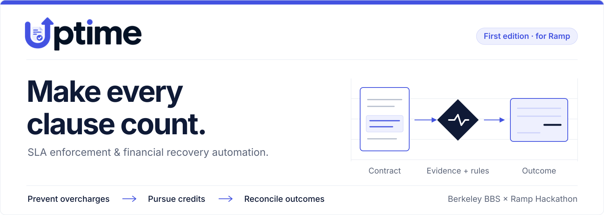
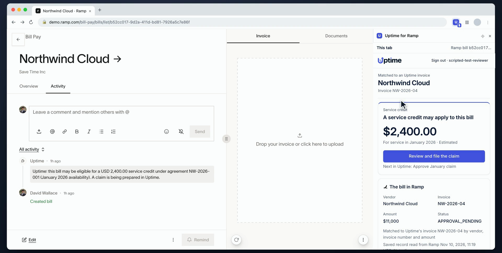
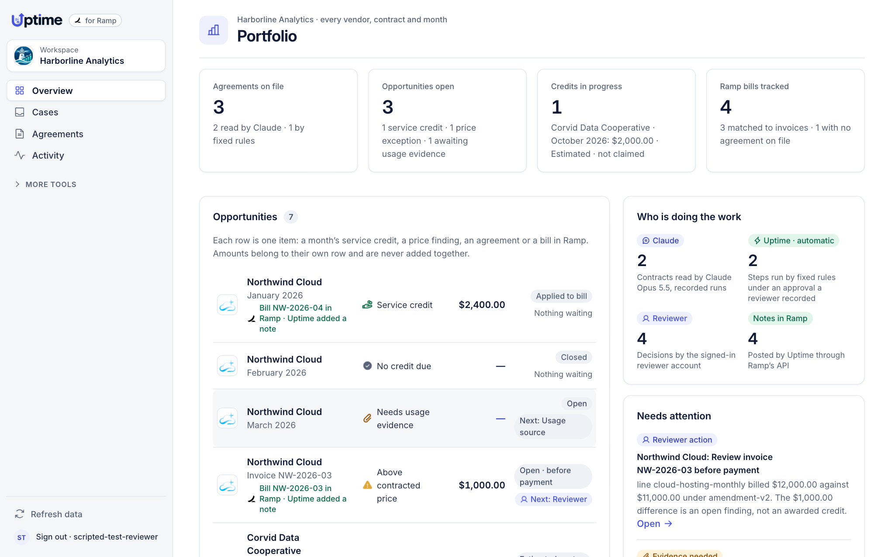
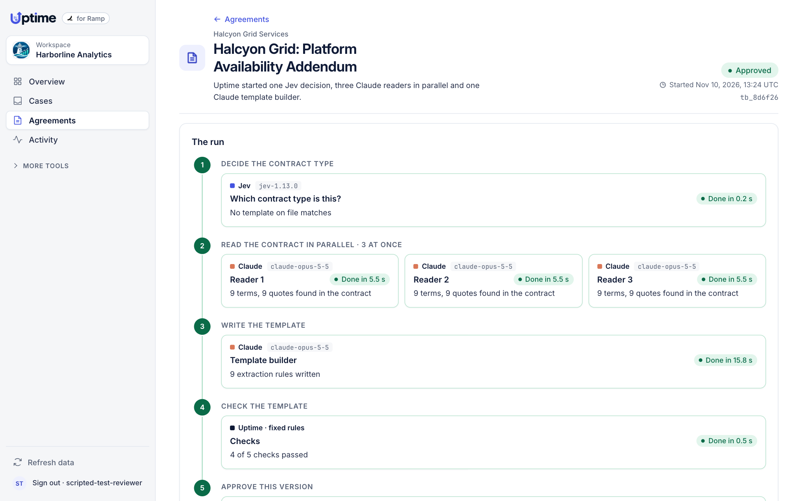
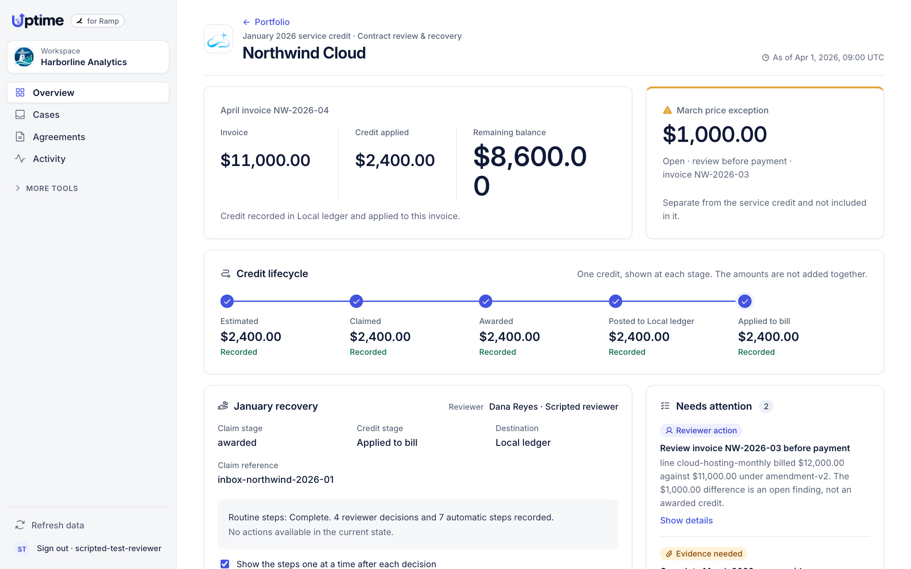
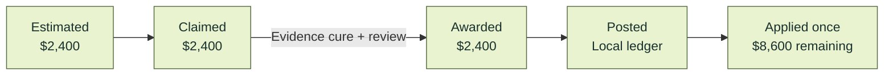
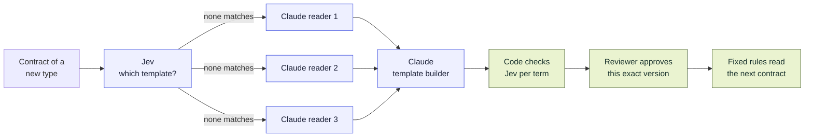
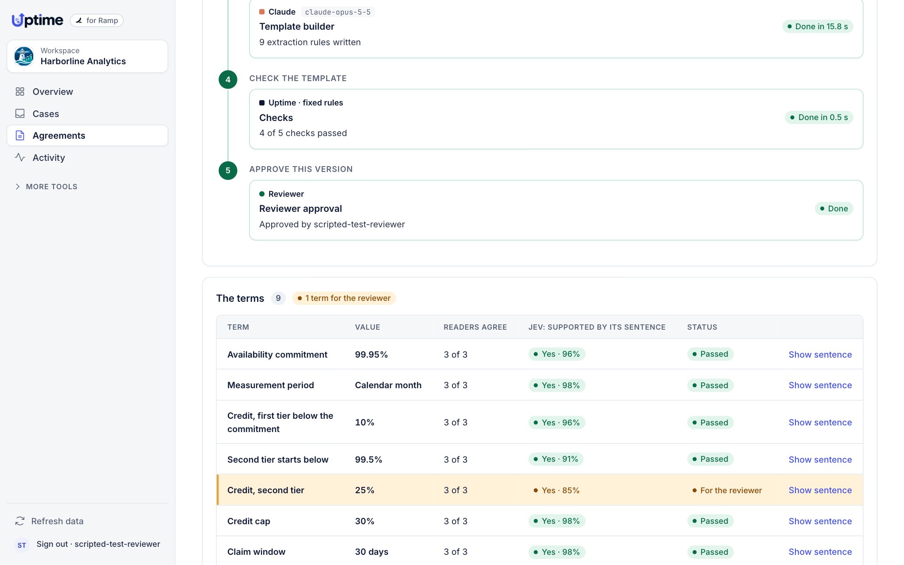
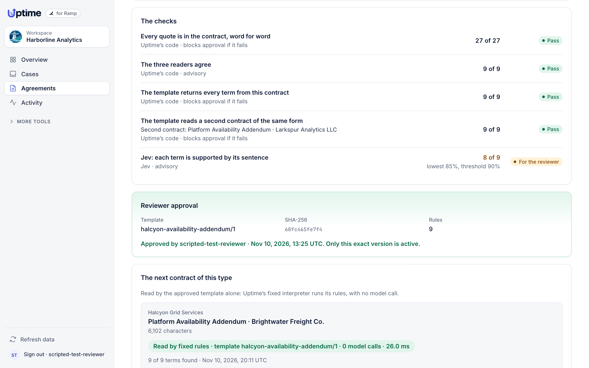
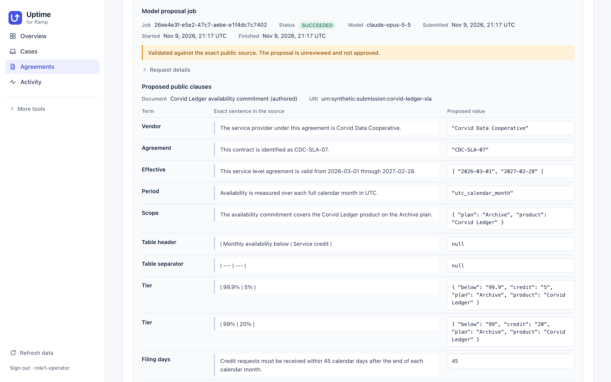

<p align="center">
  
</p>

# Uptime

**Uptime checks vendor bills against the contracts behind them (SLA credits, negotiated prices, amendments) and carries each finding from clause to claim to credit. The first edition is built around Ramp.**

Built for the **Berkeley BBS × Ramp Hackathon: Automate the Old Way**.

[](https://github.com/ronoktanvir/uptime/actions/workflows/check.yml) [](pyproject.toml) [](#where-ramp-fits)

[Watch the film](docs/demo/film/uptime-demo.mp4) · [Run it](#run-it) · [Where the AI is](#where-the-ai-is) · [Where Ramp fits](#where-ramp-fits) · [What works today](#what-works-today) · [Judge guide](docs/JUDGES.md)

<p align="center">
  <a href="docs/demo/film/uptime-demo.mp4"></a>
</p>

<p align="center"><em>A frame from the <a href="docs/demo/film/uptime-demo.mp4">2:48 demo film</a>. The bill and Uptime's note are real records in Ramp's sandbox; the panel is Uptime's real page for that bill. The browser window around them is drawn. <a href="docs/demo/film/README.md">How the film was made</a>.</em></p>

## The old way

A service credit is rarely automatic. Under [Twilio's API SLA](https://www.twilio.com/en-us/legal/service-level-agreement/twilio-apis) (section 3, last updated April 9, 2026), the customer opens a support request with the subject "SLA Claim", lists the dates and times of the outage, attaches documentation, and does it within 30 days of the end of the month. The credit is 10% of the affected month's fees, applied to future charges and never refunded. Negotiated prices have the same gap: an amendment lowers the fee, and the next invoice can still arrive at the old one.

| | The old way | With Uptime |
|:---|:---|:---|
| **Know what you are owed** | Reread the SLA, the order form and every amendment. | Terms become typed rules, each linked to its clause. |
| **Prove it** | Total the downtime in a spreadsheet. | Evidence is matched to the service month. Missing evidence gives "needs evidence", never a guess. |
| **Claim it in time** | Remember the window, write the ticket. | The deadline is tracked; the claim packet waits for a reviewer's approval. |
| **Handle the reply** | Hunt for whatever the vendor asks for. | A request in wording the rules know is answered with evidence that arrives through a signed source and is matched to it. Other wording goes to a reviewer. |
| **Confirm the money** | Hope the next invoice is lower. | Claimed, awarded, posted and applied are separate stages of one credit, applied once. |

We do not publish a time or dollar saving: no measurement supports one, and public outage reports alone cannot establish what a particular customer is owed.

## What it looks like

**1. It starts on the bill, in Ramp.** Uptime reads bills through Ramp's API and matches each to an invoice under a vendor agreement by vendor, invoice number and amount. On a match it leaves a note on the bill, and its side panel beside Ramp shows the credit, the clause it comes from, quoted exactly, and the inputs. A bill with no agreement behind it says so.

**2. One page for every vendor, contract and month.** The portfolio lists each opportunity on its own row (a month's service credit, a price finding, an estimate for a second vendor, a bill with no agreement) and counts who did the work: Claude, Uptime's fixed rules, the reviewer.

<p align="center">
  
</p>

**3. A contract type it has never read gets a reader built for it.** A decision model, Jev, finds no template on file that matches. Uptime starts three Claude agents to read the contract in parallel and a fourth to write a template: one extraction rule per term, stored as data. Code checks every quote and runs the template on a second contract; Jev checks each term against its sentence; a reviewer approves that exact version. From then on that contract type is read by fixed rules, with no model call. [More below.](#where-the-ai-is)

<p align="center">
  
</p>

**4. The claim takes four reviewer decisions.** Approve the claim; Uptime files it, takes in the vendor's request for a log and the log's verification, and drafts the response. Approve the response; the vendor awards the credit. Two more decisions post it and apply it: April's invoice goes from $11,000.00 to $8,600.00 in Uptime. After each decision the steps it set off are shown one at a time, tagged by who took them.

<p align="center">
  
</p>

**5. And back on the bill.** Uptime's second note says the credit was awarded and what the balance is in Uptime. The vendor's credit sits on file in Ramp, not yet applied: [what that means](#where-ramp-fits).

## How it works

1. **Read.** Known contract wording is parsed by fixed rules. For other wording, Claude Opus 5.5 proposes the terms as data, each tied to the sentence it came from, and code validates the proposal. For a new contract type, several Claude readers and a template builder produce rules that a reviewer approves once. Nothing a model proposes takes effect until a reviewer approves that exact version.
2. **Decide.** Code computes eligibility, deadlines and money with exact decimal arithmetic. A model never decides an amount, and unknown stays unknown.
3. **Act.** Uptime runs routine steps itself: taking in replies and evidence that arrive through signed sources, matching them, and sending a response a reviewer already approved. It stops for every judgment and every financial change.

## One case, down to the clause

The walkthrough runs one agreement through the same engines as everything else. **Its contract, usage records and invoices are authored for the demo; the vendor (Northwind Cloud) and buyer are fictional.** The vendor's replies come from a local counterparty built into Uptime, and credits are recorded in a local ledger. Nothing is sent to a real vendor. In Ramp's sandbox, the only thing Uptime writes is a note on the bill.

The SLA promises 99.9% monthly availability, a 10% credit for each completed 0.1 point of shortfall and a 30-day claim window. An amendment lowers the monthly fee from $12,000 to $11,000 from March.

| Period | What Uptime found | Result |
|:---|:---|:---|
| **January** | 135 unavailable minutes of 44,640: two completed steps below target. | `20% × $12,000.00 = $2,400.00` credit. Claimed, awarded after an evidence cure, then applied once to April's bill: `$11,000.00 − $2,400.00 = $8,600.00`. |
| **February** | 5 unavailable minutes of 40,320: target met. | Not eligible. No claim. |
| **March** | Usage evidence is incomplete. | SLA outcome **not determined**. |
| **March invoice** | Billed $12,000.00 after the amendment set $11,000.00. | **$1,000.00** price finding, open before payment and separate from the credit. |



These are stages of **one $2,400 credit**, not amounts to add, and the $1,000 price finding is not a credit. [Contract and evidence package](fixtures/northwind/README.md) · [Workflow read-back receipt](docs/v4/evidence/demo-path-87/northwind-socket.json)

## Run it

You need Git, Python 3.11–3.14 and [uv](https://docs.astral.sh/uv/). No Ramp account, credentials or model access are needed for the walkthrough.

```sh
git clone https://github.com/ronoktanvir/uptime.git && cd uptime
uv run --locked python scripts/setup_northwind.py --directory "$HOME/uptime-demo/northwind-01" --serve
```

The second command installs the locked dependencies, builds a fresh walkthrough workspace in that folder and serves it.

1. Open [127.0.0.1:8776](http://127.0.0.1:8776/).
2. Sign in with the account name and credential file the command prints. The account, `scripted-test-reviewer`, is a scripted test reviewer, not a person.
3. **Overview** is the portfolio. Open **Northwind Cloud · January 2026** and approve the January claim. Four decisions in all (approve the claim, approve the response, post the credit, apply it) bring April's bill to $8,600.00.

Use a new folder name for each fresh run; add `--resume` to reopen one. [Full setup and troubleshooting](docs/v4/NORTHWIND-WORKFLOW.md)

Optional, each added to the same command:

| Option | What it turns on | What it needs |
|:---|:---|:---|
| `--template-builder` | On **Agreements**, "Build a reader with Claude agents" for a contract type Uptime has not read. | The [Claude Code CLI](https://claude.com/claude-code), signed in on this machine. For Jev's checks, a TypeSafe API key saved in `~/.config/uptime/jev-api-key`; without it the run says Jev could not be reached and shows no Jev result. |
| `--model-jobs` | Live Claude readings of three sample contracts on **Agreements**. | The Claude Code CLI. |
| `--ramp-records DIR` | Bills read from Ramp, matched to invoices, on the portfolio and in the panel. | Records read from your own Ramp sandbox: [connection guide](docs/v4/RAMP-DEMO-CONNECTION.md). |
| `--ramp-notes` or `--ramp-notes auto` | Uptime's notes on matched bills, by a button or by itself. | A Ramp sandbox credential with `bills:write`. |
| `--side-panel-origin chrome-extension://ID` | The Chrome side panel beside Ramp. | [Loading the extension](extension/README.md). |

## Where the AI is

Models propose. Code and a person decide. No model computes money, and nothing a model writes runs as code.



**The template builder.** One real run, the one in the film:

<p align="center">
  
</p>

- **Jev** ([TypeSafe AI](https://docs.typesafe.ai/)'s decision model, `jev-1.13.0`) returns typed decisions with probabilities. It makes two kinds here: which template a contract follows (a choice), and whether a term is supported by its sentence (a yes or no). It answered in about 0.2 seconds. It is never used for arithmetic, dates or deadlines.
- **Three Claude Opus 5.5 readers** ran in parallel, about 5.5 seconds each, with tools off. Each returned the same nine typed terms with the sentence each came from. All 27 quotes were found in the contract word for word, and the readers agreed on all nine terms.
- **A fourth Claude call** wrote nine extraction rules in 15.8 seconds. A rule is a regular expression with one capture group and a type. Uptime's interpreter runs it with a length limit and a time limit, and refuses a rule that contains the value it is meant to find.
- **Code checked the template**: it returned every term from the contract (9 of 9) and read a second contract of the same form correctly (9 of 9).
- **Jev confirmed 8 of 9 terms.** One came back at 85%, under the 0.90 threshold, and was marked for the reviewer, who read its sentence before approving. That check is advisory; the code checks block approval if they fail.
- **After approval**, the next contract of that type was read by the template alone: 9 of 9 terms, no model call, 0.9 milliseconds.

<p align="center">
  
</p>

**What that run does not show.** The three sample contracts are authored, and they are the same form word for word apart from numbers, names, dates and addresses. So the run shows rules generalising across a form, not surviving different wording, and accuracy is unmeasured. The repair step for a rule that fails has only run against stand-ins, because real output passed first time. [Interface and limits](docs/demo/TEMPLATE-BUILDER.md) · [Sample contracts](fixtures/template_builder_demo/README.md)

**Single readings.** Claude Opus 5.5 also proposes contract terms for wording the fixed rules do not know, and proposes a reading of a vendor's reply, with the cited text, for a reviewer to check. Both run through the ordinary application routes with tools off. The output is a proposal: it cannot approve itself, invent evidence or set an amount. Northwind's own agreement is read by fixed rules with no model call.

<p align="center">
  
</p>

**On authored contracts, recorded November 9:**
- Of two contracts written inside the supported grammar, one (Corvid Ledger) reached shadow with 11 exact quotations from its text.
- The other (Halden Relay) was refused for the same vendor-naming reason as the independent cohort.
- A third, a deliberate control, was refused.
- An authored unclear vendor reply was read as unsupported, citing the whole reply, and went to a reviewer with nothing awarded.
- An authored reply asking for the January log in other words was read as a request for the right document. Claude also tagged the month, which the reply gives without a year, and Uptime's checks will not act on a period that is not one exact month. The claim stayed with a reviewer and nothing was awarded.

[Recorded runs](docs/v4/submission/onboarding-runbook.md) · [Recorded reply reading](docs/v4/evidence/submission-disputes-20261109/denial-model-job.json) · [Reworded log request](docs/v4/evidence/submission-disputes-20261109/reworded-model-job.json)

**On contracts it has not seen, a single reading is not reliable yet.** In the latest independent first pass, 12 actual Opus calls returned and all 12 proposals failed validation: 0 of 4 intended positive contracts reached shadow, all 6 contracts were refused, and all 8 dispute cases stopped at setup, so held-out dispute accuracy is unmeasured. A refusal names the passage it stopped at; it never produces a number. This is the gap the template builder is aimed at: a model that builds a reader once, behind checks and a reviewer, only has to be right once. [Independent results](docs/v4/evaluation-finish-20261109/RESULTS.md)

**How it was built.** A coordinator ran parallel AI coding agents, each in its own worktree with its own files, behind the test suite below. The template builder went from request to a real run in under an hour that way: three agents at once, on one shared interface page.

## Where Ramp fits

Uptime runs **beside Ramp**, as a separate local application with a Chrome side panel. Ramp stays the system of record. Everything below is in Ramp's demo sandbox, not a customer business.

**Reads.** Through Ramp's developer API, Uptime reads bills, vendors, transactions, purchase orders and approvals, and shows when each record was read and whether the list was complete.

**Matching.** A Ramp bill is matched to an Uptime invoice only when vendor name, invoice number and amount all agree. One cent off does not match.

**Notes.** Started with `--ramp-notes`, Uptime posts a note on a matched bill through Ramp's API and counts it only once it has read the note back. The notes have fixed shapes; nothing else can be sent. Four are on the sandbox bills now: a possible credit on each of two bills, a price exception on a third, and, after the claim, the credit awarded and the balance in Uptime. Reading a page never writes to Ramp: notes go out at start-up, after a reviewer's decision and after a refresh.

**The side panel.** It reads only the active tab's address, shows Uptime's page for that bill, and opens the case in the full app. Nothing runs inside Ramp's page. [How to load it](extension/README.md)

**What was set up by hand for the demo.** The Northwind and Corvid vendors and their three bills were entered in the sandbox by the engineering agent, at Ronok's instruction, in a browser he had signed in to; Uptime then read them back through the API. No payment was set up, approved or sent. [The full record](DEMO-NOTES.md)

**What Uptime does not do in Ramp.**
- It does not create or apply a vendor credit. Ramp's published API has no operation for it. For the film, the vendor's credit (`NW-CM-2026-01`, $2,400.00) was entered by hand in the sandbox. Ramp will not apply it to the bill until the bill has a payment method, and none was set, so Ramp shows it as "Not applied".
- So the $8,600.00 is April's balance in Uptime's own ledger. The bill in Ramp is unchanged apart from Uptime's notes.
- Payment holds and approval-chain steps are not built.
- The Northwind agreement is never attached to an unrelated bill: the DocuSign bill in the sandbox shows "no agreement on file".

## What works today

| Area | What works | Limits that matter |
|:---|:---|:---|
| **Money engine** | SLA credits, price checks, amendments, deadlines, exclusions and credit allocation, with exact decimal arithmetic and a clause citation for every amount | Supports specific contract wording families; anything else is refused, with the passage named |
| **Contract reading** | Fixed rules for known wording; Claude Opus 5.5 proposals for other wording, validated by code and staged in shadow | Single readings are not reliable yet: 1 of 2 authored contracts reached shadow in the recorded runs, and 0 of 4 intended positives in the latest independent pass |
| **Template builder** | For a new contract type: Jev triage, three Claude readers, a Claude-written template stored as data, code checks, Jev per term, approval of the exact version, then fixed rules | One contract form, three authored samples of it; accuracy on other wording unmeasured |
| **Disputes** | Denial → evidence cure → reviewed response → award, with routine steps run automatically and a reviewer deciding each judgment | Evidence requests are recognized only in wording the rules know. Held-out dispute accuracy unmeasured. Replies come from a local counterparty; no real vendor is contacted |
| **Approvals** | A reviewer approves the claim, the response, posting and application; each approval is bound to the exact content approved | In the walkthrough the presenter acts as a scripted test reviewer account; that is not a record of an enrolled person's approval |
| **Ramp reads** | Bills, vendors, transactions, purchase orders and approvals from the Ramp sandbox, with read time and completeness; bills matched to invoices by vendor, invoice number and amount | Each read is started explicitly; the demo uses the sandbox, not a customer business |
| **Ramp write-back** | Fixed notes on matched bills, posted through Ramp's API and read back | Notes only. No vendor credit, payment hold or approval step is written to Ramp |
| **Where credits land** | A local ledger, with exact bill and remaining balance | Not money recovered in Ramp |
| **Hosting** | Local, loopback-only application | No hosted installation or Ramp OAuth sign-in yet |

[Full capability matrix](docs/v4/CAPABILITIES.md)

## Verification

The badge above runs the full check suite on every push to `main`. Every full run on `main` is kept with its exact commit, command and log in [the receipts folder](docs/v4/evidence/submission-20261109/), including failed and aborted runs, and listed in [the integration table](docs/v4/submission/COORDINATION.md#integration-and-suites). These are regression results, not a measure of model accuracy or production readiness.

```sh
uv run --locked pytest
node --test web/*.test.cjs tests/helpers/*.test.cjs
uv run --locked python scripts/rehearse.py
uv run --locked python scripts/check_repo.py
```

An independent acceptance run checked the earlier frozen build `52f1a2f` from a fresh clone, following only the published instructions, and then the redesigned interface at `08852a6` and `008c4af`: [acceptance report](docs/v4/submission/acceptance.md) ([summary](docs/JUDGES.md#independent-acceptance)). The Ramp notes, the portfolio and the template builder came after it, on November 10, and have not had an independent run. [What that day's work did differently](DEMO-NOTES.md)

## Engineering records

Everything below is engineering history: how the product was built, tested and decided. None of it is needed to run the walkthrough.

- [The film: what is live, composited and synthesized](docs/demo/film/README.md) · [its narration](docs/demo/film/narration.md)
- [November 10 notes](DEMO-NOTES.md): what was entered in Ramp's sandbox and by whom, and what the template builder is. [Tests changed that day](DEMO-CHANGES.md)
- [Engineering map](docs/ENGINEERING-MAP.md): what is demonstrated and what is still open. The interactive dependency map runs locally with `python3 scripts/serve_progress.py --port 8780`, then [127.0.0.1:8780](http://127.0.0.1:8780/) ([access and updates](progress/README.md)).
- [Current status](docs/v4/STATUS.md) · [Capability matrix](docs/v4/CAPABILITIES.md) · [Decision records](docs/v4/decisions/INDEX.md) · [Use cases and sources](docs/product/USE-CASES.md)
- [Independent evaluation results](docs/v4/evaluation-finish-20261109/RESULTS.md) · [Remediation pass](docs/v4/FINISH-20261109.md) · [First public baseline](docs/v4/evaluation76/BASELINE.md)
- Connected Ramp worklist: `./Open\ Uptime.command` on macOS, with the [operator guide](docs/v4/OPERATIONS.md) and [connection guide](docs/v4/RAMP-DEMO-CONNECTION.md). These are local development services, not a public deployment.
- [Third-party notices](docs/v4/submission/THIRD-PARTY-NOTICES.md): the interface bundles Phosphor icons (MIT), three typefaces (Inter, Source Serif 4 and JetBrains Mono; SIL Open Font License 1.1) and company pictures supplied by Ronok.
- [Contribution workflow](CONTRIBUTING.md) · [Original specification](docs/uptime-v3/Uptime_V3_Product_Technical_Spec.md)
