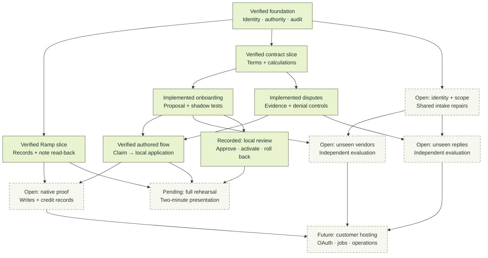

# From contract to verified financial outcome

[Uptime](../README.md) / Engineering map

Uptime's first edition joins Ramp records to a contract enforcement engine. This map describes the work already demonstrated and the dependencies that still stand between the current implementation and broader deployment. It is a **November 8, 2026 snapshot**, not a percentage-complete estimate or a live agent monitor.

[Implementation history](https://github.com/ronoktanvir/uptime/commits/main/) · [Continuous integration](https://github.com/ronoktanvir/uptime/actions/workflows/check.yml) · [Interactive dependency map](../progress/README.md) · [Detailed status](v4/STATUS.md)

**Judging the submission?** Start with the [judge guide](JUDGES.md). The two-minute storyboard, script and fallback are in [the presentation record](v4/submission/presentation.md); independent results on unfamiliar contracts are in [the evaluation results](v4/evaluation-finish-20261109/RESULTS.md).

## The delivery graph

Each node names its evidence state. Solid borders mean the stated slice is demonstrated, not that the entire product area is finished. Dashed borders identify incomplete work or an approval dependency. Onboarding and dispute generalization remain parallel priorities.



The approved hackathon path uses the verified human-posted Ramp note and the authored financial workflow. It does not depend on pretending that native credit recovery is complete. The separately prepared local review exception was signed and used once on November 9: CalyxQuay revisions 6–9 are recorded under the enrolled `ronok-tanvir` account and end REVOKED at revision 9. General release promotion is still gated. [Recorded review](v4/LOCAL-REVIEW-EXCEPTION.md) · [Approved demonstration boundary](v4/DEMO-PATH-87.md)

## Find the implementation

| Concern | Primary code | Design and evidence |
|:---|:---|:---|
| **Ramp record identity** | [`ramp_records.py`](../uptime/ramp_records.py), [`ramp_workspace.py`](../uptime/ramp_workspace.py) | [Record associations](v4/RAMP-RECORDS.md), [actual connection](v4/RAMP-DEMO-CONNECTION.md) |
| **Terms and pricing** | [`pricing.py`](../uptime/pricing.py), [`pricing_terms.py`](../uptime/pricing_terms.py), [`governing_fees.py`](../uptime/governing_fees.py) | [Governing-fee validation](v4/GOVERNING-FEE-65A.md), [Northwind terms](../fixtures/northwind/README.md) |
| **Adapter generation and evaluation** | [`vendor_model_jobs.py`](../uptime/vendor_model_jobs.py), [`vendor_eval.py`](../uptime/vendor_eval.py), [`vendor_registry.py`](../uptime/vendor_registry.py) | [Application proposal workflow](v4/decisions/ADR-0074-in-app-vendor-proposals.md), [source intake](v4/SOURCE-INTAKE.md) |
| **Evidence and disputes** | [`evidence.py`](../uptime/evidence.py), [`correspondence_service.py`](../uptime/correspondence_service.py), [`correspondence_rules.py`](../uptime/correspondence_rules.py) | [Dispute runtime](v4/PHASE75-DISPUTE-RUNTIME.md), [reviewed denial bundles](v4/PHASE78-REVIEWED-DENIAL-BUNDLE.md) |
| **Native discussion** | [`ramp_workflow.py`](../uptime/ramp_workflow.py), [`verify_ramp_comment.py`](../scripts/verify_ramp_comment.py) | [Operator boundary](v4/NATIVE-OPERATOR.md), [actual same-ID read-back](v4/evidence/demo-path-87/human-ramp-note.json) |
| **Credits and allocation** | [`ramp_credit_sync.py`](../uptime/ramp_credit_sync.py), [`allocations.py`](../uptime/allocations.py), [`reconciliation.py`](../uptime/reconciliation.py) | [Credit synchronization](v4/RAMP-CREDIT-SYNC.md), [business-scoped repair](v4/RAMP-RECONCILIATION-72.md) |
| **Permission and release** | [`auth.py`](../uptime/auth.py), [`mandates.py`](../uptime/mandates.py), [`gates.py`](../uptime/gates.py) | [Reviewer mandates](v4/REVIEWER-MANDATES.md), [release evidence](v4/RELEASE-EVIDENCE.md) |
| **Evidence workspace** | [`workspace_ui.js`](../web/workspace_ui.js), [`northwind_workflow.py`](../uptime/northwind_workflow.py) | [Workspace setup](v4/NORTHWIND-WORKFLOW.md), [eleven-action verification](v4/evidence/demo-path-87/northwind-socket.json) |

## Recent work with receipts

| Checkpoint | Concrete outcome | Verification |
|:---|:---|:---|
| [`46e427c`](https://github.com/ronoktanvir/uptime/commit/46e427c) | Completed-step contract proposals, source-bound dispute proposals and business-scoped Ramp credit repair. | [3,203 tests; retained independent limitations](v4/evidence/verification-46e427c.json) |
| [`7882178`](https://github.com/ronoktanvir/uptime/commit/7882178) | Contract period/deadline grounding and explicit artifact-category guidance integrated. | [3,761 tests; original failures preserved](v4/evidence/verification-7882178.json) |
| [`50e041c`](https://github.com/ronoktanvir/uptime/commit/50e041c) | Expired-session recovery retrieves the same completed model job without generating again. | [3,763 tests and 75 JavaScript checks](v4/evidence/verification-50e041c.json) |
| [`58ac441`](https://github.com/ronoktanvir/uptime/commit/58ac441) | Exact clause explanations, separate teammate setup and read-only Ramp comment verification. | [3,884 tests; fresh workflow and actual note receipts](v4/evidence/demo-path-87/verification.json) |
| [`6bedefc`](https://github.com/ronoktanvir/uptime/commit/6bedefc) | A narrowly scoped local review exception and financial-action denial controls. | [3,967 tests; actual exception still inactive](v4/evidence/local-review-88/verification.json) |

Test totals refer to those exact checkpoints. They measure regression coverage. They are not financial recovery, independent model accuracy or permission to deploy.

## The next work, in dependency order

1. **Complete the approved demonstration boundary.** The teammate review lifecycle is recorded and the human-posted Ramp note is verified. What remains is a timed rehearsal of the combined presentation. [Rehearsal](v4/integration90/REHEARSAL.md)
2. **Resolve identity and claim-scope decisions.** Preserve exact source identities across onboarding and claims; represent whole-service and resource-specific obligations explicitly. These are shared dependencies for the paused evaluation work.
3. **Evaluate onboarding and disputes in parallel.** Finish the application-path runners, freeze them, run the new independent cases once and report supported-case success separately from appropriate refusal. Known-case repairs do not replace that evidence.
4. **Establish deeper native financial proof.** Use an authorized supported workflow and actual provider credit/bill records. The previously rejected agent posting operation remains restricted; another tool or credential is not an alternate route.
5. **Prepare customer operation after the team selects that milestone.** Customer OAuth, managed identity, live evidence enrollment, delivery, durable callbacks, backups and deadline monitoring remain distinct requirements.

This is an explanation of existing dependencies, not approval to resume paused engineering, change priorities or activate a permission. The [team decision handoff](v4/TEAM-DECISION-HANDOFF.md) records the choices and disagreements.

## Follow progress from your own machine

```sh
git clone https://github.com/ronoktanvir/uptime.git
cd uptime
python3 scripts/serve_progress.py --port 8780
```

Open [localhost:8780](http://127.0.0.1:8780/). Search by workstream, select a task and inspect its dependencies and evidence. The underlying [progress snapshot](../progress/data.json) has a timestamp; refreshing the page does not query agents or change application state.

[Contribution guide](../CONTRIBUTING.md) · [Product use cases](product/USE-CASES.md) · [Architecture](v4/ARCHITECTURE.md) · [Current capability matrix](v4/CAPABILITIES.md)
