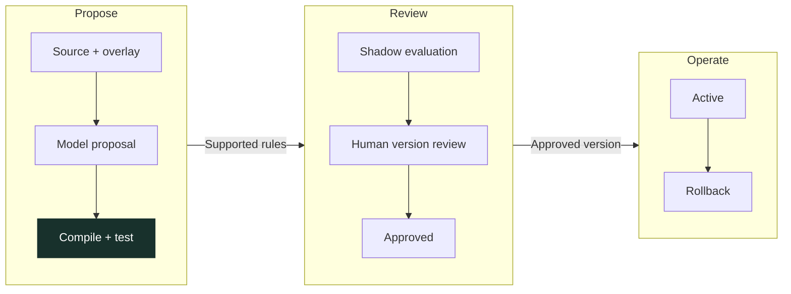

# Where Uptime earns its place

[Uptime](../../README.md) / Product use cases

Uptime connects a contractual right to the financial record that can realize it. Its first edition is built around Ramp, while its contract and evidence engines address a broader problem: negotiated terms need to remain enforceable after a purchase is approved.

The examples below separate the source of the obligation, the workflow it motivates and the implementation evidence. Public vendor terms explain the use case; they do not establish a particular customer's entitlement. Sources were checked on **November 8, 2026**. Runtime evaluation uses its pinned governing document, not an unreviewed replacement fetched from the web.

## Recover an eligible API service credit

**For:** a finance team and the engineer responsible for a critical API dependency.

Twilio's API SLA requires a timely support request and supporting outage information. It defines eligible fee categories, excludes several charges and applies credits to future fees. An incident notification alone does not establish the credit amount. [Twilio API SLA, sections 1, 3 and 4](https://www.twilio.com/en-us/legal/service-level-agreement/twilio-apis)

Uptime's corresponding workflow joins the governing SLA, customer service scope, incident evidence, eligible fees and filing deadline. The evaluator calculates the supported credit and identifies missing evidence before a claim can advance.

**Implemented evidence:** contract-specific Twilio rules and controlled customer facts in the [Twilio fixture package](../../fixtures/twilio/README.md), [evaluator](../../uptime/twilio.py) and [evidence decision](../decisions/ADR-0006-twilio-evidence.md). Actual customer entitlement and external claim delivery remain separate work.

## Catch an amendment that did not reach the invoice

**For:** accounts payable and the owner of a negotiated software agreement.

A new price becomes effective, but a vendor continues billing the old amount. The comparison requires the amendment's effective date, applicable service period and fee basis; the invoice total alone is insufficient.

The authored Northwind agreement changes its monthly fee and cap from **$12,000 to $11,000 on March 1**. The March invoice still requests $12,000. Uptime's deterministic pricing engine produces a **$1,000 finding**, cites the amended terms and keeps the finding separate from the January SLA credit. [Agreement and invoice evidence](../../fixtures/northwind/README.md)

**Implemented evidence:** [pricing engine](../../uptime/pricing.py), [governing fee controls](../v4/GOVERNING-FEE-65A.md) and [verified financial walkthrough](../v4/evidence/demo-path-87/northwind-socket.json). This agreement is authored for the demonstration. It is not evidence against the separate DocuSign bill in Ramp.

## Resolve the denial instead of stopping at claim generation

**For:** the finance operator pursuing a credit and the reviewer responsible for its contractual basis.

A denial can be correct, curable or genuinely ambiguous. Those outcomes require different actions. A system that answers every denial with another demand increases operational and commercial risk.

In the authored Northwind flow, the vendor requests missing evidence. Uptime acquires the corresponding log, verifies it through a separate source role, prepares the permitted follow-up and preserves the original filing history. The award then passes through its own authority and allocation checks. Correct denials and unsupported interpretations take separate deterministic paths.

**Implemented evidence:** [dispute runtime](../v4/PHASE75-DISPUTE-RUNTIME.md), [reviewed denial bundles](../v4/PHASE78-REVIEWED-DENIAL-BUNDLE.md) and the [eleven-action workflow receipt](../v4/evidence/demo-path-87/northwind-socket.json). Vendor replies and the award in this walkthrough are authored. Reliable handling of unseen responses and a real external delivery round-trip remain open.

## Add a vendor without adding executable vendor code

**For:** procurement or contract operations reviewing a newly purchased service.

Atlassian's SLA distinguishes eligible products and plans, defines a 15-day submission window after month-end, and applies confirmed credits to future charges. Those differences illustrate why a new vendor needs a reviewed ruleset and customer overlay. [Atlassian SLA, sections 1–2 and appendices A–B](https://www.atlassian.com/legal/sla)

Uptime's adapter lifecycle is:

**Implemented evidence:** an actual model-generated Aster candidate reached SHADOW through the application; CalyxQuay exercises the versioned lifecycle and rollback controls. [Actual provider/browser receipt](../v4/evidence/browser-public-onboarding-82.json) · [CalyxQuay live review status](../v4/LOCAL-REVIEW-EXCEPTION.md)

The current intake uses supported rule profiles. This is not yet proof of autonomous interpretation of arbitrary vendor terms. The [independent evaluation record](../v4/evaluation76/BASELINE.md) preserves the failures as well as the successes.

## Put the finding where the bill is reviewed

**For:** a Ramp Bill Pay approver who needs the reason and evidence before taking action.

Ramp exposes resource-linked comments and vendor-credit records with bill allocations. Those interfaces make the exact native record the integration destination: a finding belongs with its bill, and an applied credit needs the corresponding provider reference. [Ramp API reference: comments and vendor credits](https://docs.ramp.com/llms-api.txt)

The demonstrated path is a person posting an evidence-gap note on the real Ramp demo bill, followed by Uptime independently reading the same comment ID and body twice. It establishes native visibility and read-back, not Uptime-origin posting or a payment hold. [Sanitized read-back receipt](../v4/evidence/demo-path-87/human-ramp-note.json)

For recovery, Uptime keeps **estimated → claimed → awarded → recorded → applied** stages separate. The implemented Northwind example applies its $2,400 once in the Local ledger. A live Ramp award-to-credit-to-bill reconciliation still requires actual corresponding financial records. [Reconciliation design](../v4/RAMP-CREDIT-SYNC.md) · [Supported Ramp surfaces and access requirements](../v4/RAMP-FEASIBILITY.md)

## The product boundary

The common mechanism is **agreement → evidence → deterministic decision → authorized action → verified outcome**. The first edition attaches that mechanism to Ramp. Expanding to other financial systems remains future work; it does not change the requirement to preserve exact identity, source authority and financial state.

[Explore the implementation map](../ENGINEERING-MAP.md) · [Read the architecture](../v4/ARCHITECTURE.md) · [Return to Uptime](../../README.md)
