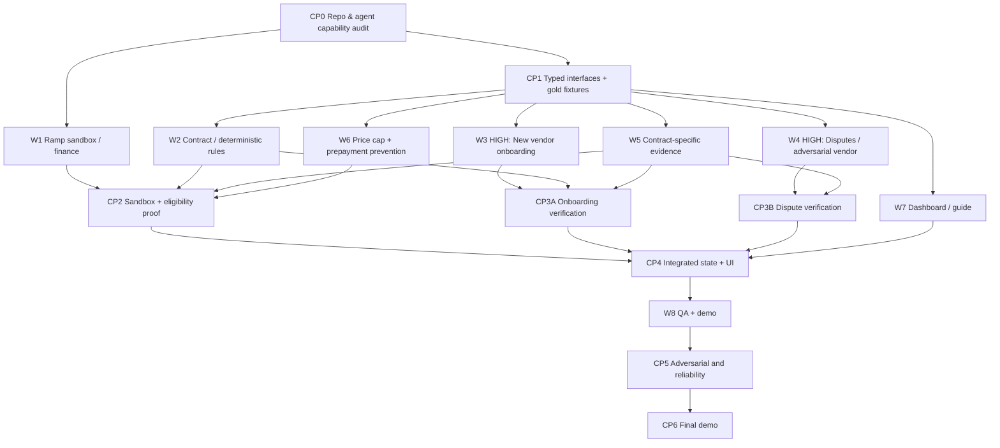
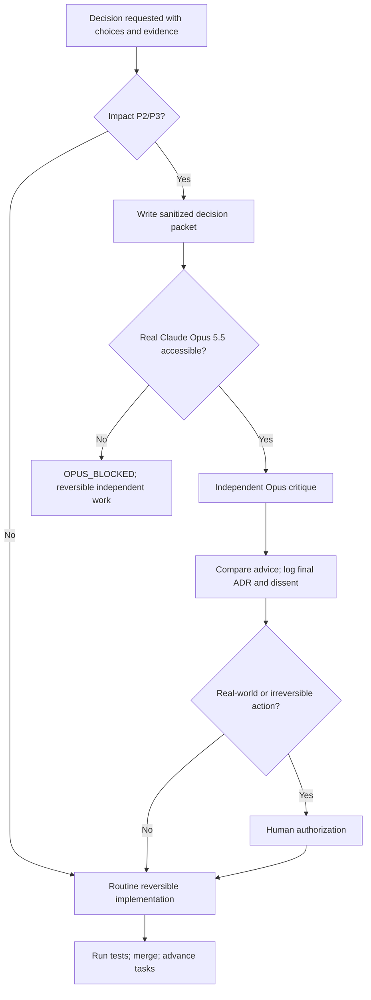

# Uptime V3 — Updated dependency DAGs and checkpoint contract

## Engineering DAG (source is also in `Uptime_V3_Work_DAG.dot`)

**Critical concurrency requirement:** W3 and W4 launch at the same time as soon as CP1 has stable typed mocks. They may NOT be serialized while waiting for live Ramp credentials, full evaluator completion, or UX. Each owns code in separate files/branches. If a subagent limit is reached, keep both provisioned and active as equal-priority first-class tracks; do not drop one without team direction. W1/W2/W5/W6/W7 can proceed concurrently.

## Decision DAG (source is also `Uptime_V3_Decision_Governance.dot`)

## Checkpoints and objective exit criteria

| Gate | Exit requirement | Evidence artifact |
|---|---|---|
| CP0 | No repo work overwritten; environment/model/Opus capability checked; available Ramp credential path determined | `STATUS.md`, `BLOCKERS.md`, git status and smoke-check results |
| CP1 | Shared interface types compile; gold fixtures and stub providers pass; W3/W4 spawned in parallel; impactful type decisions have actual Opus ADR | Contract tests, active agent/task records, ADR |
| CP2 | Real Ramp sandbox ID round-trip when available (or documented scope blocker); Twilio and price-cap eligible/ineligible/unknown/unsupported produce cited deterministic traces | Ramp object IDs and test outputs; capability matrix |
| CP3A | Atlassian adapter created as *declarative* template, correct plan/tiers/claim window/evidence, tests + shadow evaluations, reviewer promotion and rollback | Onboarding test report and approval audit |
| CP3B | Vendor simulator independently rejects/awards; dispute agent cures missing evidence, accepts valid denial, escalates ambiguous dispute; deadlines/idempotency | Frozen test oracle and three trace artifacts |
| CP4 | Dashboard loads real/fixture state, claim/dispute/reconcile tracks persistent across restart; provenance tags and policies enforced | E2E tests, DB restart test |
| CP5 | Prompt injection, access-control, monetary correctness, overcounting, retries, simulator independence and demo-backup QA | Security + property + E2E CI reports |
| CP6 | 2-minute reproducible demo + side-by-side Ramp UI and accurate LIVE/SIMULATED flags; final README, limitations, ADRs | Demo runbook, recording/script, screenshots |

## Parallel work ownership and merge hygiene

- Orchestrator owns `packages/contracts` public interfaces and `docs/orchestration`. Freeze changes at CP1; use additive versions and contract tests.
- W3 and W4 **never** write the same files; separate branches/worktrees. W3 owns generated vendor adapters and onboarding lab APIs, W4 owns claim/dispute/rebuttal state and simulator. They coordinate through typed `Case`, `Evidence`, `EvaluationResult` and `ExternalAction` objects.
- W1 and W6 coordinate around Ramp bill models; W2 owns financial evaluators; W5 owns incident data; W7 owns front end; W8 owns test harness and demo. Each agent returns tests + changes + assumptions + open blockers.
- Run integration tests at every merge; no merge of model-generated contract rules without deterministic tests and evidence references. Keep all Ramp client credentials outside repo and out of model contexts.
- If tool execution lacks actual background services, persist queues and provide explicit resume commands. The DAG is a plan, **not proof that jobs are running**.
